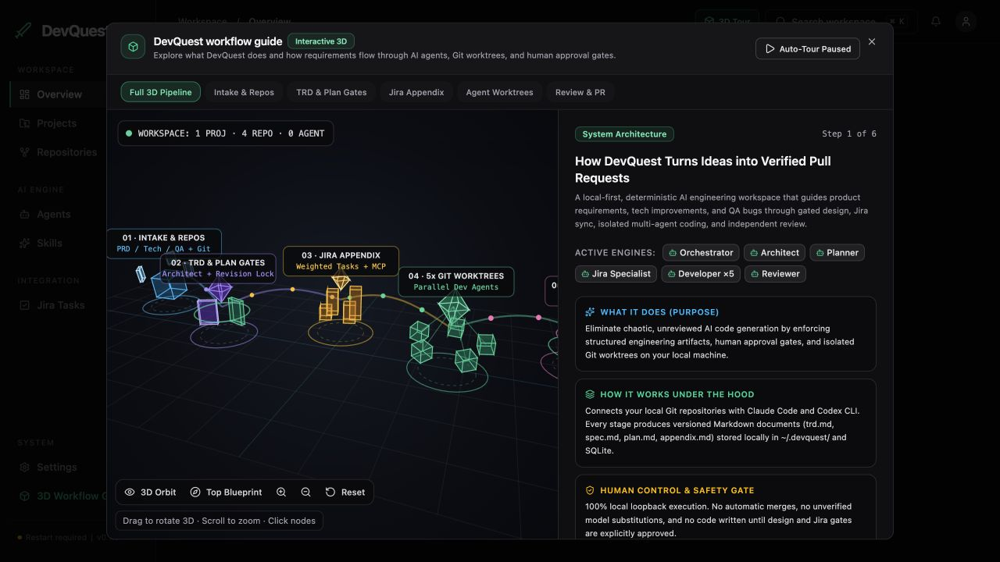
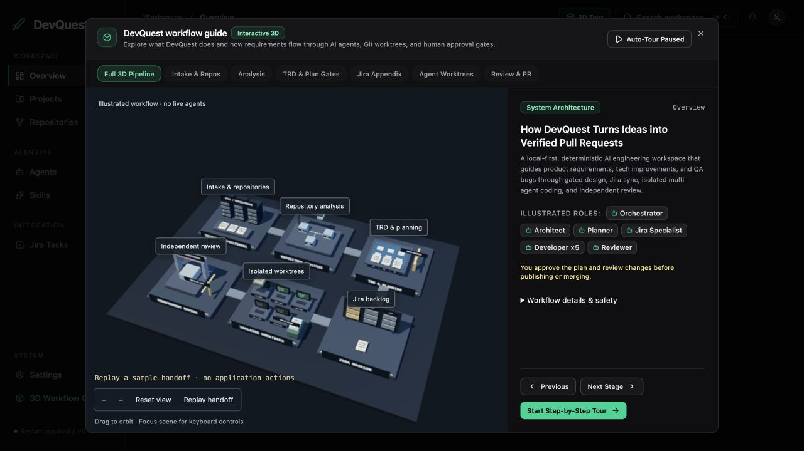
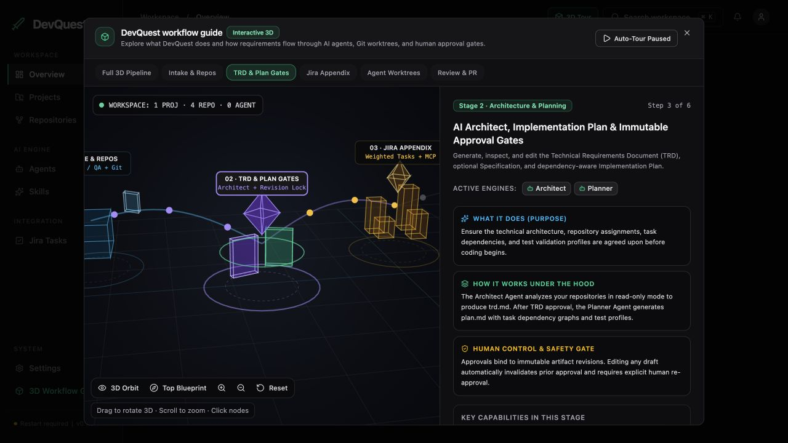
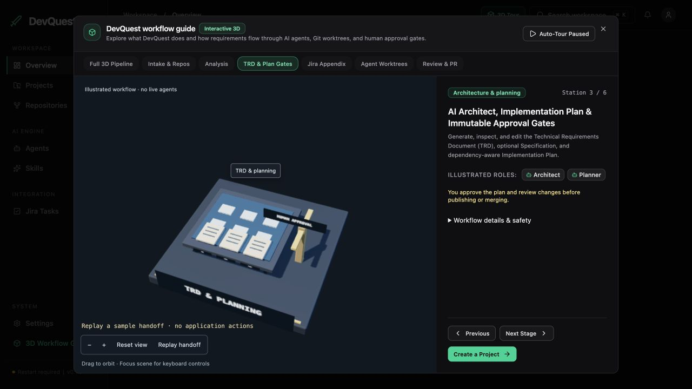
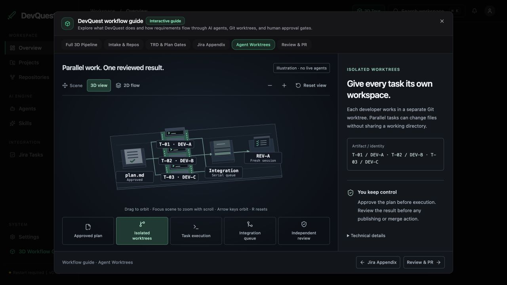
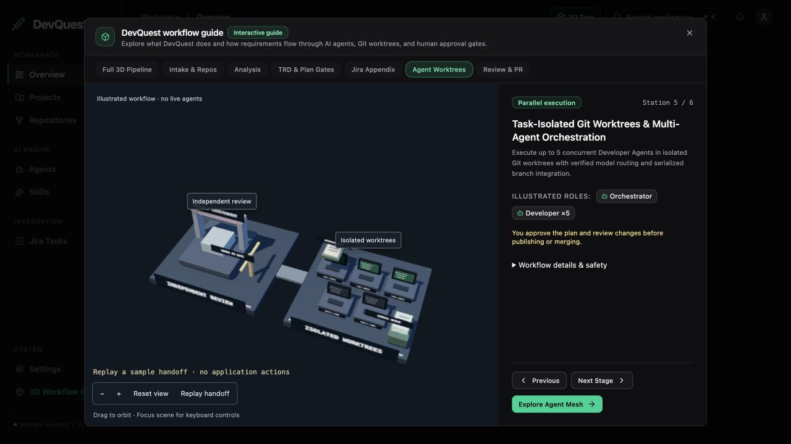
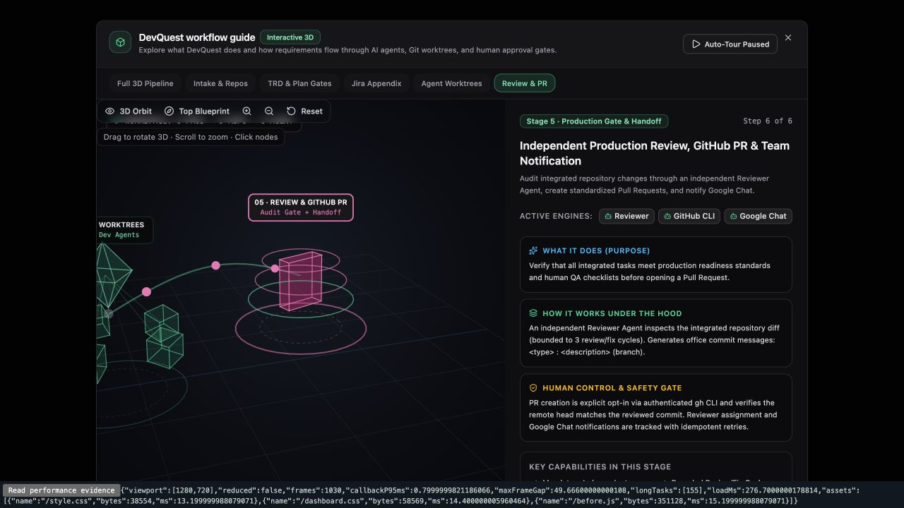
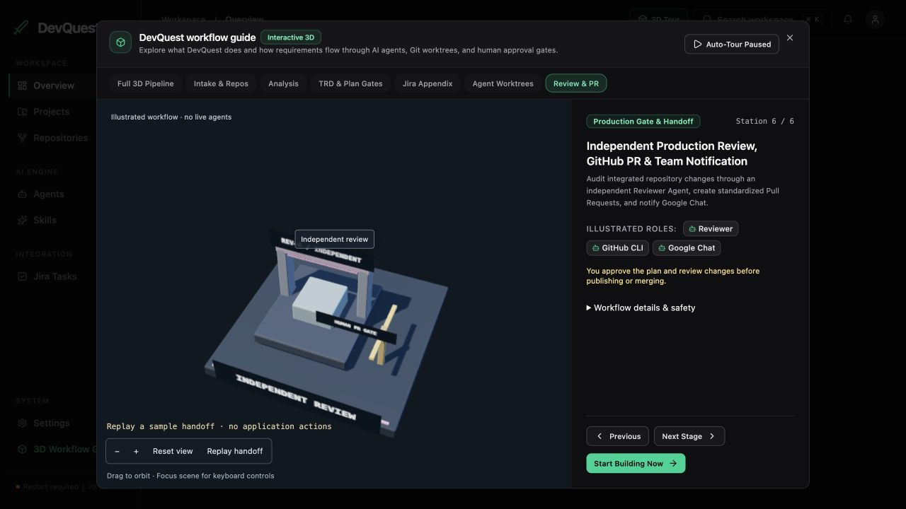

# Engineering diorama — actual WebGL redesign

Implemented 22 October 2026. Frontend only; no workflow, Jira, agent, repository, security, or persisted Quest changes. No paid AI calls, commits, pushes, or PRs.

## Verified original limitations

The original `Onboarding3DCanvas` manually projected wire cubes, rings and octahedra into a **Canvas 2D** context. It had no depth buffer, actual lights, surface materials, or shadow maps. Camera offsets were stage presets rather than geometry-derived framing. A continuous animation loop rotated shapes even when idle. The previous worktree-only implementation was projected SVG; it did not replace the pipeline renderer.

That renderer and the separate SVG worktree implementation have been removed. The existing modal, application callbacks, completion storage, stage navigation and technical explanations are retained. An explicit analysis station brings the scene to six stations plus an overview.

## Actual scene changes

`ui/engineering-scene.js` builds a Three.js WebGL environment with cached beveled box geometry, depth testing, standard metallic/rough materials, hemisphere fill, warm key light, blue fill light, and a 2048-pixel shadow map. No bloom, particles, spinning ornaments, remote textures, or model downloads.

| Station | Physical geometry |
|---|---|
| Intake | Three storage racks with server bays, specification tray, document stack |
| Analysis | Inspection bench, API/data/service blocks, dependency channels and overhead inspection arm |
| Planning | Supported blueprint table, diagram blocks, TRD/spec/plan documents, closed human approval gate |
| Jira | Supported three-column backlog board with physical task cards |
| Worktrees | Five desks with monitors and keyboards; stable T-01/DEV-A, T-02/DEV-B, T-03/DEV-C identities and two clearly free slots; approved-plan stand and separate serial-result queue |
| Review | Separate REV-A inspection arch, integrated payload, moving scanner and closed human PR gate |

Broad conveyor sections connect the shared stations. Focus views hide unrelated stations and connectors; the worktree focus includes the independent review chamber. Both HTML labels and physical placards identify the scene. Labels and actual meshes are selectable.

The replay follows **one sample task**: approved plan → T-01/DEV-A → validated T-01 result → serialized queue → independent REV-A. It does not suggest that a task moves between developers. Other desks illustrate parallel capacity. Every scene is explicitly labeled illustrative; no activity is presented as actual telemetry. Human gates remain closed; no simulated approval changes the application.

## Camera, interaction and lifecycle

Camera distance is computed from all eight bounding-box corners in the current camera basis, aspect ratio and field of view. This includes the reviewer in the hero view. Orbit and zoom are bounded; transitions settle and stop. Pointer drag, focus-scoped wheel, zoom buttons, reset, arrow keys, +/- and R/Home work. Raycasting selects the clicked physical station without treating a drag as a click.

The renderer is initialized only when the guide mounts. Pixel ratio is capped at 1.5. Geometry and materials are reused. Animation runs only during camera transitions or an 8.5-second replay. Closing disposes geometries, textures, materials, shadow targets, event listeners, resize observer, animation frame and WebGL renderer. Reduced motion uses immediate framing and a static handoff. Missing WebGL or lost context exposes semantic HTML stage navigation and descriptions.

No separate network asset loader was needed for procedural geometry. **Three.js remains inside the dashboard bundle**, so transfer/parsing is not deferred, although renderer initialization is deferred. This is a known loading cost.

## Asset provenance

All station geometry and label textures were authored locally in code for this application. No downloaded third-party models or images. Three.js **0.186.1**, including RoundedBoxGeometry, is MIT-licensed; see [license](licenses/three-MIT.txt). Official renderer reference: [Three.js WebGLRenderer](https://threejs.org/docs/pages/WebGLRenderer.html).

## Visual evidence

All desktop comparisons use **1280 × 720**. The first three before captures are from the running application. Review-before uses the retained pre-change UI bundle in a local isolated fixture with its original split layout restored; surrounding toolbar placement differs, so compare the scene geometry rather than toolbar position. No screenshot content was retouched.

| Stage | Before | After |
|---|---|---|
| Pipeline |  |  |
| Planning |  |  |
| Worktrees |  |  |
| Review |  |  |

[Real-browser handoff recording](evidence/webgl/handoff-demo.gif) — sampled screenshots with their measured capture intervals, not synthetic interpolated animation. [Timing](evidence/webgl/recording-timing.json).

[390 × 680 layout](evidence/webgl/after-narrow.jpg) · [Orbit/zoom](evidence/webgl/interaction-orbit.jpg) · [WebGL failure](evidence/webgl/fallback.jpg) · [Reduced motion](evidence/webgl/reduced-motion.jpg).

## Validation and measurements

- Production UI build and syntax checks passed.
- Full regression suite: **364 passed, 2 skipped, 0 failed** (366 total). Retired SVG-specific tests were removed with that renderer.
- Following the final animation and mesh-picking refinement, focused scene/dashboard suite: **17 passed**.
- Framing tests cover narrow/wide aspect ratios, minimum/default/maximum orbit, pitch and zoom, testing every bounding corner.
- Browser: all stage selections, mesh selection (planning), drag orbit, zoom, reset, tab arrow navigation, canvas keyboard orbit/reset, replay completion, narrow layout, semantic fallback navigation, reduced motion, and console inspection. No warnings/errors observed in the normal application tab. The intentionally unavailable WebGL fixture produces the expected renderer initialization error and renders the fallback.
- Reduced-motion fixture: five rendered frames after initialization, stage selection and static handoff; unchanged on a later read. OS accessibility preference itself was not changed; the fixture overrides only the relevant media query.
- Real app idle verification: **1,064 → 1,064 frames** between observations, proving no continuing scene frame loop. See [idle evidence](evidence/webgl/idle-verification.json).
- Real app worktree/review view: **167 draw calls, 46,822 triangles**, 72 geometries and 29 textures resident after visiting stages; mean CPU render-submission time **0.67 ms** over the recorded session, initial scene creation-to-first-render **167 ms**.
- Isolated fixture overview: **384 draw calls, 107,452 triangles**, 71 geometries/29 textures; scene first render **109.4 ms**, mean submission **1.18 ms**. Page load **389.5 ms**, measured RAF callback p95 **3.2 ms**, startup/resize long tasks **180/75/79 ms**. See [measurement snapshot](evidence/webgl/performance.json).
- These are local samples, not GPU frame times, FPS guarantees, process RSS or sustained CPU utilization. Browser automation and screenshots affect timings. No low-end physical laptop or mobile GPU benchmark was performed.
- Dashboard bundle approximately **1.12 MB uncompressed**, versus about 599 KB for the prior SVG slice. CSS approximately 53 KB. Procedural assets require no additional downloads. The larger JavaScript bundle is the main performance tradeoff.

## Remaining limits

Physical desk labels are small in the full overview; focused views and semantic HTML labels carry readability. Narrow screens show a scrollable scene plus explanation rather than a detailed workstation close-up. The visual language is intentionally stylized and procedural, not photorealistic. There is no GPU timing/heap benchmark or cross-browser/device matrix. Generated Three.js shader strings retain upstream whitespace that `git diff --check` flags; source files have no such findings.

Application entry actions retain their callbacks, but were not submitted during this visual test to avoid creating projects or touching integrations. The existing application's “Restart required”/workspace-loading state predates this task; it was not repaired or used to justify changing backend behavior.

## Interaction follow-up — 23 October 2026

Reproduced a narrow-screen wheel bug: scrolling over the focused canvas both zoomed the camera and moved the dialog (`scrollTop` 0 → 272). Replaced React's passive wheel handler with a scoped, non-passive listener. Focused camera zoom cancels page scrolling; unfocused scrolling, horizontal-only gestures and Ctrl+wheel browser zoom remain untouched. The listener is removed on failure/unmount.

Browser verification after the fix: focused scroll remained at 0; unfocused scroll moved the dialog to 80.5. [Screenshot](evidence/webgl/focused-wheel.jpg). Production build passed; 18 focused dashboard/scene tests passed, including focus handling, browser zoom preservation and listener cleanup. Full backend regression suite was not repeated for this frontend-only event-handler correction.
